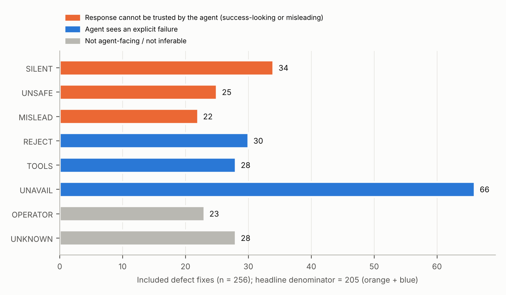

# Silent, Unsafe or Misleading: How Defects in Database MCP Servers Reach LLM Agents

**Vladimir Beskorovainyi**, Besk Tech · ORCID [0009-0004-7005-6242](https://orcid.org/0009-0004-7005-6242)

## Abstract

Coding and data agents reach databases through Model Context Protocol (MCP) tool servers; when a server is defective, what matters is what the agent sees. We mined 5,742 merged pull requests from 26 popular open-source database MCP servers, sampled 376 fix-like PRs and coded 256 confirmed defect fixes by the contract element that was wrong and by the symptom the calling agent would observe, inferred from the PR and issue text. Of 205 fixes with an agent-facing symptom, 59 (28.8%; repository-cluster bootstrap 95% CI 20.3–36.3%) would have returned a success-looking response that was wrong, incomplete or unsafe; 20.1% if guardrail defects are set aside. Adding misleading errors, 39.5% of responses could not be taken at face value. Rendering the live tool lists of 15 repositories (223 tools) through the Gemma 4 chat template, 67 of the 223 tools in 9 of these 15 repositories lose a parameter type or structure, mostly optional parameters declared as a union with null; a short normaliser cuts this from 67 to 40 of 223 tools. We release the labelled dataset, codebook and scripts, and propose six harness checks for function-calling agents.

## 1 Introduction

An agent using a database tool trusts that the advertised schemas are what the server honours, that a successful response is correct, and that an error tells it what to change. Coding agents use the same channel to inspect schemas, run migrations and verify fixes.

Recent work studies whether agents detect silent tool failures [5, 7] and audits deployed tools for them [6]; in one live study agents detected them in 12% of runs [5]. What is missing for database tool servers is a measurement of what share of the defects maintainers actually fix are silent, unsafe or misleading, and in which part of the server. We study merged fixes, which show that maintainers accepted the behaviour as wrong, and code each from the agent's point of view.

We ask which contract elements fail (RQ1), what the agent would observe and how often the failure is invisible in the response (RQ2), which defects depend on the client or model toolchain (RQ3), how much repair work coding agents already do (RQ4), and whether current tool schemas survive translation into one model's function-calling format (RQ5, Gemma 4).

**Contributions.**
- A database-server-specific coding of real, maintainer-confirmed fixes by contract element and agent-observable symptom (256 fixes, 22 repositories), with sensitivity analyses.
- A released dataset, codebook, repository-selection record and scripts.
- A measured schema-translation check of 223 live tools against the Gemma 4 chat template, with and without a normaliser.
- Six proposed harness checks derived from the data, each with a proposed test.

## 2 Related work

**Silent tool failures.** Sun et al. [7] studied whether models detect unflagged tool errors in controlled settings. SilentProbe [5] perturbed live production APIs and found that agents detected silent failures in 12% of full-loop runs. An audit of 15 scientific tools [6] found 91 silent failures, including capped results presented as complete. These studies probe agents or tools; we measure which share of fixed defects in database MCP servers are of this kind, and name conditions such experiments could reproduce.

**Faults and vulnerabilities in MCP servers.** Taraghi et al. [1] (407 issues, 279 repositories) and Owotogbe et al. [2] (833 fault threads, 473 repositories) built general MCP fault taxonomies; Hasan et al. analysed 1,899 servers [3] and 856 tool descriptions [4]. ToFu [8] fuzzed 273 MCP servers and verified CWE-class bugs in 343 tools across 118 servers. A Datadog case study [9] showed a read-only bypass in the archived reference Postgres MCP server. Zhu et al. [10] coded 5,669 agent-framework bug reports with a symptom dimension. None of these reports the distribution of agent-visible symptoms for database servers; our element axis overlaps their categories by design.

We reuse AIDev's signature-based detection of agent-authored PRs [11].

## 3 Data and method

### 3.1 Sampling frame

**Repositories.** Sixteen GitHub repository searches pairing "mcp" with database terms (`stars:>=150`, first 50 results each) and 18 lookups by name gave candidates. We kept repositories whose primary purpose is an MCP server exposing a user's data store, with at least 300 stars on 1 November 2026. Platforms with a secondary MCP interface (e.g. graphjin, anyquery), clients, memory servers and multi-server repositories were excluded; decisions for all 107 candidates with at least 300 stars are released. Twenty-six repositories qualified.

**Pull requests.** We collected all merged PRs created 2024-11-01 to 2026-10-31 (5,742). A PR is *fix-like* if its title matches `fix|bug|crash|panic|broken|regression|incorrect|wrong` or it has a bug label (1,051). Removing bot authors, dependency bumps and non-fix conventional-commit prefixes left a frame of 821 PRs in 23 repositories. We sampled up to 40 per repository at random (376 PRs) and report frame-weighted estimates for headline figures. Evidence per PR: title, body, up to three referenced issues and changed files (missing for 12). Per-repository counts are in the appendix.

### 3.2 Codebook

- **Inclusion:** the PR repairs runtime behaviour a client or agent could experience; documentation, build, dependency-only, test, feature, refactor and non-server changes are excluded.
- **Element:** `TOOL_DEF` (names, descriptions, schemas, exposure), `INPUT`, `INTROSPECT` (schema discovery), `EXEC`, `OUTPUT`, `ERROR` (error reporting), `GUARD` (read-only enforcement, authorisation, injection, data exposure), `SESSION`, `CONFIG` (configuration, credentials, start-up), `PROTOCOL`.
- **Symptom:** `SILENT` (success with a wrong, partial or stale result), `UNSAFE` (success, but the call did something it must not), `MISLEAD` (failure with a generic, internal or wrong-cause error), `REJECT` (valid call fails with an accurate error), `TOOLS` (tool surface broken or rejected by a client), `UNAVAIL` (no start, no connection, crash, hang or timeout), `OPERATOR` (operator-visible only), `UNKNOWN`.
- **UNSAFE kind:** *policy* (the agent's own call violates a stated policy, e.g. a write in read-only mode) or *vuln* (an attacker-facing weakness: SSRF, path traversal, DNS rebinding, token exposure, injection through untrusted input).
- **Derived:** *undetectable* = `SILENT` or `UNSAFE`; *not trustworthy at face value* = undetectable or `MISLEAD`. The headline denominator excludes `OPERATOR` and `UNKNOWN` (51 fixes).

Eight decision rules are released with the codebook. One is a judgement call that adds to `SILENT`: results so large that they flood the client's context (3 fixes); we report the headline without them.

### 3.3 Agent authorship

A PR is *agent-authored* if its author is a coding-agent account or its body or merged commit carries an agent signature (Claude Code, Codex, Cursor, Devin, Jules, OpenHands). Co-author trailers from AI review bots are counted separately. Counts are lower bounds.

### 3.4 Annotation

The author labelled all 376 units against the codebook (release/CODEBOOK.md). A single coder is weaker than independent double coding, so residual errors are possible. Issue links written as URLs were added to the evidence after the first 30 units had been labelled. A script checks that every PR cited in this paper matches the dataset.

## 4 Results

256 of 376 sampled PRs (68%) were confirmed fixes. Table 1 crosses element and symptom.

### RQ1: Which contract elements fail?

Configuration and credentials lead (72, 28.1%), then guardrails (37, 14.5%) and tool definitions (32, 12.5%). Data-path elements (`INPUT`, `INTROSPECT`, `EXEC`, `OUTPUT`) account for 67 (26.2%). Frame weighting raises guardrails to 19.8%.

### RQ2: What would the agent see?

Losing the tool (`UNAVAIL`, 66) is most common. Of 205 fixes with an agent-facing symptom:

| Headline variant | Undetectable | Not trustworthy |
|---|---:|---:|
| All fixes (n = 205) | 59 (28.8%) | 81 (39.5%) |
| Without attacker-facing UNSAFE (n = 191) | 45 (23.6%) | 67 (35.1%) |
| Without GUARD (n = 174) | 35 (20.1%) | 55 (31.6%) |

Repository-cluster bootstrap 95% CIs: all fixes 20.3–36.3%, without GUARD 11.7–27.9%; frame-weighted 27.3%. Without oversized-output fixes the share is 27.7%, and with follow-up series merged 26.8% (appendix).

Silent defects concentrate in the data path (`OUTPUT` 11, `INTROSPECT` 9, `EXEC` 6, `INPUT` 3): rounded BIGINT identifiers (benborla/mcp-server-mysql#132), timestamps shifted by the host's offset (bytebase/dbhub#417), composite foreign keys reported as a Cartesian product (supabase/mcp#317), row caps skipped for CTE or `UNION` queries (bytebase/dbhub#388, #429).

The 25 unsafe successes split into 11 policy violations and 14 attacker-facing vulnerabilities. Eight policy cases are statement classifiers that missed a mutating construct (a CTE, `EXEC`, `OPENQUERY`, `$out`, a comment after `USE`, Cypher `INSERT`; e.g. bytebase/dbhub#275, mongodb-js/mongodb-mcp-server#525); one is a write mode that failed open (googleapis/mcp-toolbox#4359), two applied the wrong identity or privilege. The vulnerabilities are injection through tool inputs (5), unfenced untrusted data (3), SSRF and path escapes (3), session binding and DNS rebinding (2) and token exposure (1).

Misleading errors are mostly error-reporting defects (11 of 22): invalid SQL surfaced as a JSON-RPC internal error rather than a tool execution error, which the MCP specification describes as the channel models can use to self-correct [12] (googleapis/mcp-toolbox#3056); and a server answering "Source 'x' not found" while listing 'x' as available (bytebase/dbhub#425). Void operations that returned nothing led the model to assume failure and retry (supabase/mcp#168).

*Figure 1. Symptoms of the 256 included fixes.*

### RQ3: Client- and model-specific defects

Seventeen fixes (6.6%) appeared only with particular clients or toolchains, nine in tool definitions, e.g. schemas without `properties` (neo4j/mcp#216) and tools skipped by Gemini CLI for missing parameter types (redis/mcp-redis#59).

### RQ4: Coding agents in the repair loop

Agent signatures appear on 209 of 5,742 merged PRs (3.6%), rising from 0.7% in the first half of 2025 to 6.8% in July–October 2026. They are more frequent on fix-like PRs (81/1,051, 7.7%) than on other PRs (128/4,691, 2.7%); stratified by repository, Mantel–Haenszel odds ratio 1.95, p = 0.0006. Within the frame the figure is 79/821 (9.6%; frame vs other merged PRs, odds ratio 2.05, p = 0.0003). One repository contributes 125 agent-signed PRs. Of the 256 included fixes, 45 are agent-signed.

### RQ5: Do current tool schemas survive translation into Gemma 4 function declarations?

Google's Gemma 4 tool-calling guide passes JSON-schema dicts unchanged to `apply_chat_template` [13]; the chat template then renders them [14]. Per parameter it renders `description`, a single string `type`, `enum` (strings only), `items` (keys emitted verbatim), `nullable`, and nested `properties`/`required`; other keywords are dropped. On 1 November 2026 we ran `tools/list` on the current release of each server: 15 of 26 repositories (18 configurations, 223 tools) started without a live service; four needed dependency pins and mongodb-mcp-server was listed unconnected (details in the release). Go, Rust and SaaS-backed servers are missing.

- In 9 of 15 repositories at least one tool loses a parameter's type or structure (67 tools, 30.0%; three configurations account for 45). The main cause is optional parameters declared as `anyOf: [T, null]` (67 such parameters, spread over 43 of the affected tools), which render with an empty type; objects without `properties` render `additionalProperties` as if it were a parameter.
- A short normaliser (`anyOf [T, null]` to `type: T, nullable: true`; `$ref` inlined) leaves 40 tools in 8 repositories, from multi-type unions and free-form objects.
- 106 tools lose a constraint keyword, mostly `default`. Separately, 106 tools have an undescribed parameter, a server property rather than a template loss.

We did not run the model; whether these losses change Gemma 4's tool calls is untested.

## 5 Harness checks

These are proposed checks for function-calling agents; only C3 has been measured (RQ5). Each targets an observed class and states a proposed test.

- **C1 Result cross-check.** Beside a capped `SELECT`, run `COUNT(*)` with the same predicate; probe large-integer and timestamp columns with a round-trip query. *Proposed test:* with pre-fix bytebase/dbhub#388, #429 or benborla/mcp-server-mysql#132, the answer is correct (or flagged) with C1 and wrong without.
- **C2 Agent-side read-only policy.** Parse statements with a dialect-aware parser and block mutating constructs before the call; prefer a role without write privileges. *Proposed test:* the eight classifier bypasses in the dataset are blocked by C2 against the pre-fix servers.
- **C3 Schema normalisation per model.** At load time rewrite nullable unions, inline `$ref`, require `properties`, and report every tool not translated. *Measured:* RQ5.
- **C4 Error classification.** Treat JSON-RPC internal errors and errors without `isError` as cause-unknown; never retry a state-changing call after an empty response. *Proposed test:* on pre-fix googleapis/mcp-toolbox#3056 and supabase/mcp#168, count useless retries and duplicate mutations.
- **C5 Output budget.** Page or summarise results above a size limit. *Proposed test:* pre-fix supabase/mcp#65 completes without context overflow.
- **C6 Contract probes for server authors and coding agents.** Empty results, BIGINT and timestamp round-trips, quoted identifiers, non-public schemas, hidden mutations, parallel calls. *Proposed test:* share of dataset fixes whose pre-fix version fails a probe.

## 6 Threats to validity

**Construct.** Symptoms are inferred from text, not observed; 51 fixes are outside the headline. **Internal.** Labels come from a single coder, with no independent second coder; title-based selection misses fixes with vague titles; agent signatures are self-disclosed. **External.** Popular open-source servers over 24 months; the per-repository cap over-weights small repositories. **Author involvement.** The author contributes to googleapis/mcp-toolbox; his PRs were unmerged at collection; his issue #4332 is referenced by sampled fix #4359.

## 7 Conclusion

In 256 confirmed fixes to database MCP servers, about three in ten agent-facing defects returned a plausible but wrong or unsafe success (one in five outside guardrails), and 67 of the 223 tools we could list lose a parameter type or structure in Gemma 4's chat template (40 after normalisation). Harnesses should cross-check results, enforce their own read-only policy, normalise schemas per model and classify errors before retrying.

## Data and code availability

Dataset, codebook, selection record, appendix, schema-audit inputs and scripts (Apache-2.0): https://github.com/beskvladimir-create/db-mcp-defects. Numbers come from `scripts/analyze.py`; the schema-audit numbers come from `scripts/c3_schema_audit.py`.

**Table 1.** Element by symptom (n = 256).

| Element | SIL | UNS | MIS | REJ | TOOLS | UNAV | OPER | UNK | Total |
|---|---:|---:|---:|---:|---:|---:|---:|---:|---:|
| CONFIG | 2 | 0 | 1 | 4 | 0 | 45 | 9 | 11 | 72 |
| GUARD | 0 | 24 | 2 | 3 | 0 | 2 | 4 | 2 | 37 |
| TOOL_DEF | 1 | 0 | 0 | 0 | 28 | 0 | 1 | 2 | 32 |
| SESSION | 2 | 1 | 2 | 1 | 0 | 12 | 7 | 0 | 25 |
| EXEC | 6 | 0 | 5 | 10 | 0 | 0 | 0 | 4 | 25 |
| ERROR | 0 | 0 | 11 | 0 | 0 | 1 | 2 | 2 | 16 |
| OUTPUT | 11 | 0 | 1 | 1 | 0 | 0 | 0 | 2 | 15 |
| INPUT | 3 | 0 | 0 | 8 | 0 | 0 | 0 | 3 | 14 |
| INTROSPECT | 9 | 0 | 0 | 3 | 0 | 0 | 0 | 1 | 13 |
| PROTOCOL | 0 | 0 | 0 | 0 | 0 | 6 | 0 | 1 | 7 |
| Total | 34 | 25 | 22 | 30 | 28 | 66 | 23 | 28 | 256 |

## AI tools

An LLM assistant (Claude) was used to write the data-collection and analysis scripts.

## References

[1] Taraghi M. et al. Real Faults in Model Context Protocol (MCP) Software: a Comprehensive Taxonomy. arXiv:2603.05637v2, 2026.
[2] Owotogbe J. et al. A Taxonomy of Runtime Faults in Model Context Protocol Servers. arXiv:2606.05339, 2026.
[3] Hasan M. M. et al. Model Context Protocol (MCP) at First Glance: Studying the Security and Maintainability of MCP Servers. arXiv:2506.13538, 2025.
[4] Hasan M. M. et al. Model Context Protocol (MCP) Tool Descriptions Are Smelly! arXiv:2602.14878, 2026.
[5] Li Z. et al. SilentProbe: Measuring Silent Failure in Production APIs Used as Agent Tools. arXiv:2609.00035, 2026.
[6] Singh D. et al. Silent Failures in Agent-Tool Interaction: An Audit of ToolUniverse. arXiv:2609.26836, 2026.
[7] Sun J. et al. Tools Fail: Detecting Silent Errors in Faulty Tools. arXiv:2406.19228, 2024.
[8] Ananto M. N. I. et al. ToFu: Exploiting and Fuzzing the LLM-Orchestrator-Tool Trust Boundary. arXiv:2610.13651, 2026.
[9] Mola S. MCP vulnerability case study: SQL injection in the Postgres MCP server. Datadog Security Labs, 21 Aug 2025. https://securitylabs.datadoghq.com/articles/mcp-vulnerability-case-study-SQL-injection-in-the-postgresql-mcp-server/
[10] Zhu X. et al. Where Agent Frameworks Fall Short: Examining Functional Challenges and Usability Concerns. arXiv:2602.21806, 2026.
[11] Li H., Zhang H., Hassan A. E. AIDev: Studying AI Coding Agents on GitHub. arXiv:2602.09185, 2026.
[12] Model Context Protocol Specification 2025-11-25, Server: Tools. https://modelcontextprotocol.io/specification/2025-11-25/server/tools (accessed 2026-11-01).
[13] Google DeepMind. Tool calling, Gemma documentation. https://gemma.ai/get-started/capabilities/function-calling/ (accessed 2026-11-01; replaces the deprecated ai.google.dev page).
[14] Google. Gemma 4 chat template, google/gemma-4-E2B-it revision 8995379, as copied in huggingface/trl `trl/chat_templates/gemma4_v5.jinja` (commit a03b8fe). https://github.com/huggingface/trl/blob/a03b8fe31d5f68b645ccf0d6b95c1f1245b5006e/trl/chat_templates/gemma4_v5.jinja
